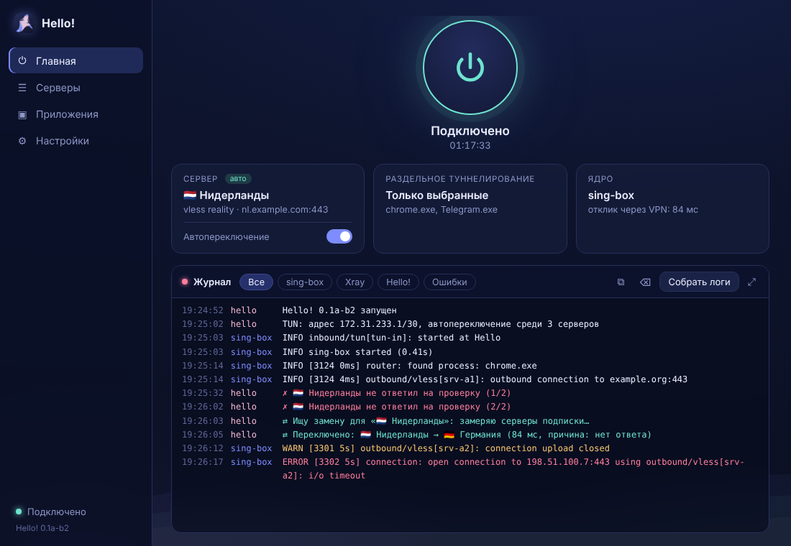
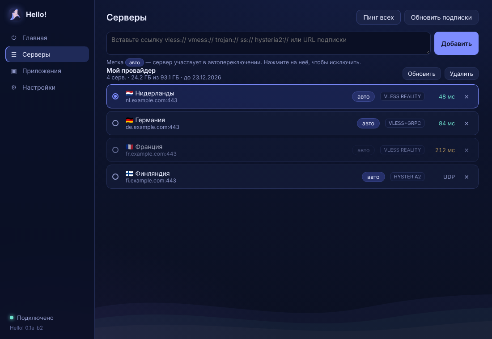

<div align="center">


# Hello!

**VPN-клиент для Windows**

Свои серверы и подписки · раздельное туннелирование · автопереключение

`0.2a-b2` · Windows 10/11 x64 · ядро [sing-box](https://github.com/SagerNet/sing-box), опционально [Xray](https://github.com/XTLS/Xray-core)

</div>

---

<p align="center">
  
  
</p>

## Что умеет

- **Раздельное туннелирование.** Через VPN идут только выбранные программы — или, наоборот, все, кроме них.
- **Свои серверы и подписки.** Вставьте ссылку на свой сервер или подписку от провайдера. Подписки обновляются сами, видно остаток трафика, срок действия и объявления провайдера. Подписки, которые открываются только в Happ, тоже работают.
- **Автопереключение.** Если сервер перестал отвечать, Hello! сам переключится на самый быстрый из рабочих.
- **Логи в один клик.** Архив для разбора проблем — без паролей, ключей и адресов серверов.
- **Не мешает другим клиентам.** Спокойно стоит рядом с NekoBox и подобными.

## Поддерживаемые протоколы

| Протокол | Транспорт и защита |
|---|---|
| **VLESS** | TCP, WebSocket, gRPC, HTTPUpgrade, XHTTP\* · TLS, Reality, Vision |
| **VMess** | TCP, WebSocket, gRPC, HTTPUpgrade · TLS |
| **Trojan** | TCP, WebSocket, gRPC, HTTPUpgrade · TLS |
| **Shadowsocks** | AEAD и Shadowsocks 2022 |
| **Hysteria2** | обфускация Salamander, прыжки портов |

Серверы добавляются ссылкой (`vless://`, `vmess://`, …) — по одной, списком или подпиской. Подписка может быть списком ссылок (обычным или в base64) или JSON-конфигом Xray/sing-box.

<sub>\* XHTTP работает через ядро Xray (переключается в настройках; Hello! скачает его при первом подключении).</sub>

## Установка

Скачайте из [Releases](../../releases) один из файлов:

- **`Hello-Setup-<версия>-win-x64.exe`** — установщик с ярлыками на рабочем столе и в «Пуске»;
- **`Hello-<версия>-win-x64-portable.zip`** — без установки: распакуйте в любую папку и запустите `Hello.exe`.

> Установщик пока не подписан сертификатом, поэтому Windows SmartScreen может показать «Windows защитила ваш компьютер» → **Подробнее** → **Выполнить в любом случае**.

Hello! запускается с правами администратора — они нужны для TUN-интерфейса.

## Сборка из исходников

Hello! написан на [Tauri 2](https://tauri.app) (Rust), интерфейс — HTML/CSS/JS без сборщика. Понадобятся:

| Что | Установка |
|---|---|
| Rust (MSVC) | `winget install Rustlang.Rustup` |
| Visual Studio Build Tools с C++ | `winget install Microsoft.VisualStudio.2022.BuildTools --override "--quiet --wait --add Microsoft.VisualStudio.Workload.VCTools --includeRecommended"` |
| Node.js 22+ (для Tauri CLI) | `winget install OpenJS.NodeJS.LTS` |

| Файл | Что делает |
|---|---|
| `build.bat` | проверяет инструменты, скачивает sing-box, гоняет тесты и собирает установщик и portable-архив в `release\<версия>\` |
| `run.bat` | запускает Hello! из исходников (`tauri dev`) с правами администратора |

Подробности сборки — в `build.log`. Вручную:

```bat
npm install
npm run fetch-cores        :: sing-box.exe в bin\
cargo test -p hello-core   :: тесты разбора ссылок, конфигов, диагностики
npx tauri build            :: установщик в target\release\bundle\nsis\
```

## Как устроено

```
 Hello! (Tauri, Rust)                       sing-box.exe
 ┌──────────────────────────┐   конфиг    ┌───────────────────────────────┐
 │ интерфейс (WebView2)     │ ──────────▶ │ TUN + правила process_name /  │
 │ подписки · трей · логи   │             │ process_path                  │
 │ сторож автопереключения  │ ◀─Clash API─│ selector из серверов подписки │
 │ автоперезапуск ядра      │             └──────┬───────────────┬────────┘
 └──────────────────────────┘              выбранные программы   остальные
                                                 │                  │
                                           VPN-сервер (или     напрямую
                                           SOCKS → xray.exe)
```

Когда окно закрыто, Hello! остаётся в трее без WebView — работает только маленький процесс на Rust и sing-box.

| Путь | |
|---|---|
| `crates/hello-core/` | логика без привязки к Windows: разбор ссылок, конфиги sing-box и Xray, адрес TUN, вырезание секретов. Покрыта тестами |
| `src-tauri/src/core.rs` | запуск ядер, автоперезапуск, автопереключение через Clash API |
| `src-tauri/src/app.rs` | команды интерфейса, трей, окно |
| `src-tauri/src/subs.rs` | подписки |
| `src-tauri/src/procs.rs` | список запущенных программ с иконками |
| `src-tauri/src/diag.rs` | «Собрать логи» |
| `src-tauri/src/cores.rs` | загрузка Xray по требованию |
| `ui/` | интерфейс |
| `scripts/` | загрузка ядер, версия |

Настройки — в `%APPDATA%\Hello\launcher.json` (общие с Electron-версией 0.1a, подписки переезжают сами).

## Планы

- Служба Windows вместо запроса прав администратора при каждом запуске.
- Подписки в формате Clash (YAML).

## Иконка

Иконка сделана на основе чужого арта (подпись художника есть на оригинале); права на исходный рисунок принадлежат его автору.

## Нашли ошибку?

[Создайте issue](../../issues/new/choose) и приложите архив из «Собрать логи».
